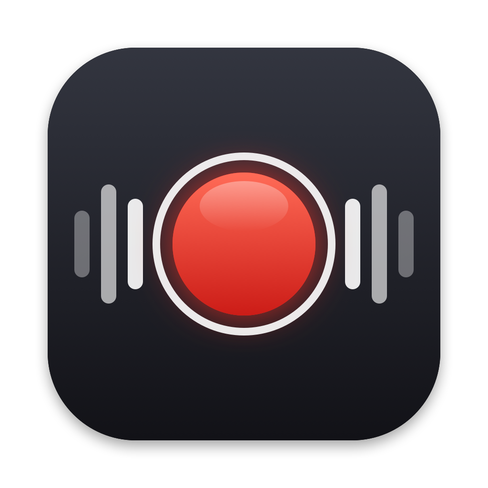

# AudioTap

A small macOS menu bar app that records everything your Mac plays to an MP3. Click the icon to start, click it again to stop, and Finder opens with the new file selected.



- Records all system output through Core Audio's process tap API, so you don't need BlackHole, Loopback or any other virtual audio device. You keep hearing the audio while it records.
- Notification and alert sounds are left out of the recording.
- Optionally trims silence from the start and end of each recording (on by default, toggled from the right-click menu). The trim is a stream copy, so the MP3 isn't re-encoded.
- Writes 192 kbps MP3 files to `~/Music/AudioTap/`, named by date and time.

It's one Swift file with no Xcode project and no dependencies beyond ffmpeg.

## Requirements

- macOS 14.2 or later. Process taps arrived in 14.2. It has been tested on macOS 27 on Apple Silicon.
- Xcode Command Line Tools, for `swiftc`.
- ffmpeg from Homebrew (`brew install ffmpeg`). The app looks for it at `/opt/homebrew/bin/ffmpeg` and `/usr/local/bin/ffmpeg`.

## Install

```sh
git clone https://github.com/dwm8/audiotap.git
cd audiotap
./build.sh
```

`build.sh` compiles the app, gives it an ad-hoc signature, copies it to `/Applications/AudioTap.app` and launches it. The record icon appears in the menu bar.

The first time you record, macOS asks for permission to record system audio. Allow it. You can change this later in System Settings > Privacy & Security > Screen & System Audio Recording.

The app is signed ad hoc, not with a developer ID, so every rebuild changes its signature and macOS may ask for that permission again. For the same reason a copy built on one Mac and sent to another will be blocked by Gatekeeper; build it on the Mac that will run it.

## Use

- Left-click the icon to start recording. The icon turns red and shows the elapsed time.
- Left-click again to stop. The MP3 is finished (and trimmed, if trimming is on), then shown in Finder.
- Right-click (or Control-click) for Open Recordings Folder, Trim Silence at Start and End, and Quit.

To start it at login, add `/Applications/AudioTap.app` in System Settings > General > Login Items.

## Building with an agent

These steps are written for a coding agent (Claude Code, Codex and similar) building AudioTap on a user's Mac. Run each check and stop at the first failure.

1. Check the macOS version. It must be 14.2 or later.

   ```sh
   sw_vers -productVersion
   ```

2. Check for the Swift compiler. If `xcode-select -p` fails, ask the user to run `xcode-select --install` and finish the installer, since it opens a dialog that needs a person.

   ```sh
   xcode-select -p && swiftc --version
   ```

3. Check for ffmpeg with the LAME MP3 encoder, and install it with Homebrew if it's missing.

   ```sh
   ffmpeg -hide_banner -encoders 2>/dev/null | grep -q libmp3lame || brew install ffmpeg
   ```

4. Build and install. A successful run ends with `installed /Applications/AudioTap.app`.

   ```sh
   ./build.sh
   ```

5. Verify that it captures audio. The binary has a test mode that records for a fixed number of seconds without the menu bar and prints the path of the MP3. Play a sound during the recording, then measure it:

   ```sh
   /Applications/AudioTap.app/Contents/MacOS/AudioTap --test 4 > /tmp/audiotap-test.txt &
   sleep 1; afplay /System/Library/Sounds/Submarine.aiff; wait
   f=$(cat /tmp/audiotap-test.txt)
   ffmpeg -hide_banner -i "$f" -af volumedetect -f null - 2>&1 | grep max_volume
   ```

   A `max_volume` well above -91 dB means the capture works (that sound peaks at about -9 dB at full level). -91 dB is digital silence, which usually means the audio recording permission wasn't granted. The first test run can trigger the permission prompt for the terminal app the agent runs in, so ask the user to click Allow and run the test again. Delete the test file afterwards.

6. Tell the user the app is in the menu bar and how to use it (see [Use](#use)). An agent can't click the menu bar icon, so the user should make one short recording to confirm the full flow.

The trim step can be tested on its own with `AudioTap --trim <file.mp3>`, which trims the file in place.

Diagnostic messages go to stderr. When the app is launched from Finder they aren't kept anywhere, so run the binary directly from a terminal to see them.

## How it works

`main.swift` creates a global process tap (`CATapDescription` with `stereoGlobalTapButExcludeProcesses`), excluding `systemsoundserverd`, the process that plays notification and alert sounds. It wraps the tap in a private aggregate device built on the current default output device and reads the audio in an IO proc. The samples are piped as 32-bit float PCM into ffmpeg, which encodes the MP3 while you record.

The sample rate passed to ffmpeg comes from the aggregate device, not from the tap. The tap can report 48 kHz while the output device runs at 44.1 kHz, and using the tap's rate makes recordings play back fast and high-pitched.

When trimming is on, ffmpeg's `silencedetect` finds silence below -60 dB at each end, and the file is cut with `-c copy`, leaving 0.15 s of silence at each end.

Recording level doesn't depend on the system volume when the output device applies the volume itself, which was the case for the USB speakers it was tested on. Devices where macOS applies volume in software haven't been tested.

`icon.swift` draws the app icon. Regenerate `icon-1024.png` with `swift icon.swift icon-1024.png`; `build.sh` turns it into the `.icns` file.

## License

MIT. See [LICENSE](LICENSE).
